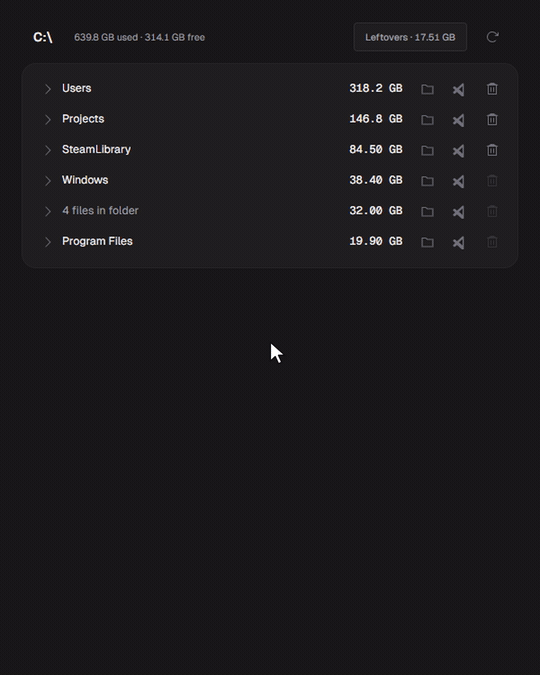

# Disk Lens

Minimalist Windows utility where folders and files are ranked by disk space across any depth of nesting.

<p align="center">
  
</p>

<p align="center">
  <a href="docs/demo.mp4">Full-resolution video (MP4 · 1080×1350)</a>
</p>

## Usage

- **Nested folders** — Any folder row can be clicked to expand nested subfolders and files to any depth.
- **App leftovers** — Data left behind by uninstalled apps is tagged with `Leftover?` and grouped under **Leftovers**.
- **Row actions** — Any item can be opened in File Explorer, opened in VS Code, or moved to the Recycle Bin from the icons on the right.

## Build

A standalone Windows executable is built and launched with Cargo:

```powershell
cargo run --release
```
